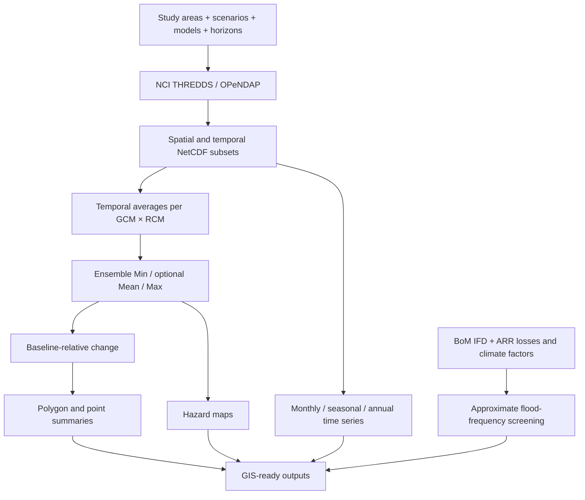

<div align="center">

# 🌏 NARCliM2 Data & Hazards Analysis

### From regional climate projections to actionable spatial hazard intelligence

**An end-to-end, configurable Python toolkit for climate data acquisition, multi-model uncertainty, geospatial analysis, climate time series, and flood-frequency screening.**

[](https://www.python.org/)


[](NARCliM_Example.ipynb)

**[Get started](#-quick-start)** · **[Explore capabilities](#-capabilities-at-a-glance)** · **[Understand the workflow](#-processing-architecture)** · **[Example notebook](NARCliM_Example.ipynb)** · **[Scientific cautions](#quality-assurance-and-scientific-interpretation)**

</div>

---

> [!IMPORTANT]
> This repository is designed for **climate-risk screening and spatial analysis**, not as a replacement for project-specific validation, hydrodynamic modelling, or probabilistic uncertainty quantification.

## ✨ Why this package?

NARCliM2.0 delivers valuable high-resolution climate information, but turning remotely hosted model datasets into consistent, reproducible GIS products can require substantial manual work. This package connects those steps in a reusable pipeline: **discover → subset → analyse → compare → map → report**.

### 🚀 Capabilities at a glance

| Capability | What it does | Key output |
|---|---|---|
| 🌐 Remote climate data access | Discovers NCI THREDDS datasets via OPeNDAP; subsets time and space | NetCDF and manifests |
| 🧭 Spatial targeting | Point/polygon study areas; multiple features; automatic regional domain selection | Feature-specific subsets |
| 🌡️ Climate hazards | Heat, cold, bushfire weather, heavy rain, drought, storm-wind exceedances | Hazard indicators |
| 🎲 Ensemble uncertainty | Temporal averaging by GCM × RCM; grid-cell ensemble min / optional mean / max | GeoTIFF, GeoPackage |
| 📈 Climate change | Future-minus-historical comparisons for matching ensemble statistics | Change rasters |
| 🗺️ Feature summaries | Zonal means for polygons; cell sampling for points | GeoPackage, CSV |
| 📅 Climate time series | Monthly/seasonal/annual rainfall totals and temperature means | NetCDF, CSV, plots |
| 🎨 Maps | Reproducible ensemble hazard visualisations | High-resolution map images |
| 🌊 Flood screening | BoM/ARR-based climate-adjusted equivalent flood frequency at selected locations | CSV, GeoPackage, curves |
| 🔎 QA & reproducibility | Processing manifests, optional storm source retention, configurable outputs | Traceable processing products |

## 🧩 Processing architecture



> [!NOTE]
> The **flood screening** branch is a separate BoM/ARR workflow. It does not run hydraulic flood inundation modelling.

## ⚡ Quick start

Clone and install the repository in a Python 3.11+ environment:

```bash
git clone https://github.com/AlluviumGroup/NARCliM2-Data-and-Hazards-Analysis.git
cd NARCliM2-Data-and-Hazards-Analysis
python -m pip install -e .
```

Run a small spatial subset (adjust the boundary path and output directory):

```python
from pathlib import Path
from narclim_workflow import run_workflow

manifest = run_workflow(
    vector_path=Path("path/to/study_area.gpkg"),
    output_root=Path("NARCliM_Outputs"),
    time_windows={"baseline": (1985, 2014), "mid_term": (2041, 2060)},
    variables=["TXge35", "R99p", "FFDIgt50"],
    scenarios=["historical", "ssp245"],
    gcms=["ACCESS-ESM1-5"],
    rcms=["NARCliM2-0-WRF412R3"],
    domain_key="auto",
    overwrite=False,
)
print(manifest["status"].value_counts(dropna=False))
```

> [!TIP]
> Begin with **one variable, one GCM, one RCM and a small time window** to validate access and output structure before running a large ensemble.

## 🌡️ Supported climate indicators

| Variable | Interpretation | Time resolution | Source |
|---|---|---|---|
| `prAdjust` | Bias-adjusted precipitation | Daily | Bias-adjusted output |
| `tasmaxAdjust` / `tasminAdjust` | Maximum / minimum temperature | Daily | Bias-adjusted output |
| `tasmeanAdjust` | Mean temperature = (Tmax + Tmin) / 2 | Derived daily | Local calculation |
| `TXge35` | Days with Tmax ≥ 35 °C | Annual | Bias-adjusted output |
| `TNlt2` | Days with Tmin < 2 °C | Annual | Bias-adjusted output |
| `FFDIgt50` | Days with FFDI ≥ 50 | Annual | DD |
| `R20mm` | Days with rainfall ≥ 20 mm | Annual | DD |
| `R99p` | Rainfall from extremely wet days | Annual | DD |
| `SPI12` | Standardised Precipitation Index (12 months) | Monthly | DD |
| `StormDays` | Annual wind-threshold exceedance count | Derived annual | Daily `sfcWindmax` |

**Storm example:** `storm_threshold_kmh=89.0` produces the indicator `StormDaysGT89`. The daily wind source is in m/s; the configurable threshold is in km/h. Retain the source subset using `save_storm_source=True` for QA.

**Model configuration:** five GCMs × two WRF RCMs provide **up to 10 ensemble members**, subject to data availability. Supported scenarios include `historical`, `ssp126`, `ssp245`, and `ssp370`. The domain selector can choose the ~4 km south-eastern Australia grid or ~18 km Australia-wide grid.

> [!WARNING]
> **Ensemble minimum and maximum are across model members after temporal aggregation.** They are **not** the most extreme individual years, nor statistical confidence bounds. Missing model/scenario combinations must not be treated as zero climate values.

## 📖 Detailed documentation

The sections below preserve the full workflow settings, examples, output naming, and scientific interpretation from the existing package documentation and example notebook.

## Repository structure

NARCliM2/
├── pyproject.toml
├── README.md
├── example.py
├── NARCliM_Example.ipynb
├── CITATION.cff
├── CHANGELOG.md
├── .gitignore
└── src/
    └── narclim_workflow/
        ├── __init__.py
        ├── catalog.py
        ├── config.py
        ├── domain.py
        ├── spatial.py
        ├── workflow.py
        ├── uncertainty.py
        ├── spatial_summary.py
        ├── ensemble_maps.py
        ├── rain_temp_timeseries.py
        └── flood.py

The modules are intentionally separated by task: workflow.py handles
NARCliM discovery/download/subsetting; uncertainty.py handles temporal
averaging and model-ensemble statistics; spatial_summary.py transfers
ensemble information to user features; rain_temp_timeseries.py retains
temporal variability; ensemble_maps.py creates maps; and flood.py
provides the separate BoM/ARR flood-frequency workflow.

## Installation

Create or activate the Python environment used for geospatial analysis,
clone the repository, then install the package in editable mode:

```bash
git clone https://github.com/AlluviumGroup/NARCliM2-Data-and-Hazards-Analysis.git
cd NARCliM2-Data-and-Hazards-Analysis
python -m pip install -e .

Editable installation means changes made under src/narclim_workflow/
are available when the package is imported; the package normally does
not need to be reinstalled after each code edit.
```

For development dependencies:

```bash
python -m pip install -e ".[dev]"

Python 3.11+ is recommended.

Test the installation:

python -c "import narclim_workflow; print(narclim_workflow.__file__)"
```

## Configuration and supported climate data

The main climate-analysis settings can be supplied directly in Python.
The following blocks show the package's configured variables, scenarios,
time horizons, GCMs, RCMs, and domains in the same form used in analysis
scripts.

Climate variables

```python
VARIABLES = [
    "prAdjust",       # bias-adjusted precipitation
    "tasmaxAdjust",   # bias-adjusted maximum temperature
    "tasminAdjust",   # bias-adjusted minimum temperature
    "TXge35",         # days with Tmax >= 35 C
    "TNlt2",          # days with Tmin < 2 C
    "FFDIgt50",       # days with FFDI >= 50
    "R20mm",          # days with precipitation >= 20 mm
    "R99p",           # precipitation from extremely wet days
    "SPI12",          # 12-month Standardised Precipitation Index
    "StormDays",      # derived wind-threshold exceedance indicator
]

Variable          Description       NCI branch               Frequency

prAdjust        Bias-adjusted     bias-adjusted-output   daily
precipitation

tasmaxAdjust    Bias-adjusted     bias-adjusted-output   daily
maximum
temperature

tasminAdjust    Bias-adjusted     bias-adjusted-output   daily
minimum
temperature

TXge35          Number of days    bias-adjusted-output   yearly
with maximum
temperature ≥35°C

TNlt2           Number of days    bias-adjusted-output   yearly
with minimum
temperature <2°C

FFDIgt50        Number of days    DD                     yearly
with FFDI ≥50

R20mm           Number of days    DD                     yearly
with
precipitation ≥20
mm

R99p            Total             DD                     yearly
precipitation
from extremely
wet days

SPI12           12-month          DD                     monthly
Standardised
Precipitation
Index
```

Daily mean temperature is derived locally rather than downloaded:

```python
tasmeanAdjust = (tasmaxAdjust + tasminAdjust) / 2
```

StormDays is also derived. For example:

```python
storm_threshold_kmh = 89.0
save_storm_source = True

creates the annual indicator:

StormDaysGT89

while optionally retaining the original daily sfcWindmax subset for QA
and alternative threshold testing.
```

Climate scenarios

```python
SCENARIOS = [
    "historical",
    "ssp126",
    "ssp245",
    "ssp370",
]
```

Not every variable is available for every scenario/model combination.
Unsupported combinations are skipped and reported instead of terminating
the complete batch.

Time horizons

Time horizons are user-defined. A typical project configuration is:

```python
TIME_WINDOWS = {
    "baseline":   (1985, 2014),
    "short_term": (2021, 2040),
    "mid_term":   (2041, 2060),
    "long_term":  (2081, 2100),
}
```

Historical NARCliM data are generally within 1951–2014, while
projection scenarios cover 2015–2100. Requested windows should be
checked against the datasets used for each project.

Global Climate Models --- GCMs

```python
GCMS = [
    "ACCESS-ESM1-5",
    "EC-Earth3-Veg",
    "MPI-ESM1-2-HR",
    "NorESM2-MM",
    "UKESM1-0-LL",
]
```

Configured realisations are:

ACCESS-ESM1-5     → r6i1p1f1
EC-Earth3-Veg     → r1i1p1f1
MPI-ESM1-2-HR     → r1i1p1f1
NorESM2-MM        → r1i1p1f1
UKESM1-0-LL       → r1i1p1f2

Regional Climate Models --- RCMs

```python
RCMS = [
    "NARCliM2-0-WRF412R3",
    "NARCliM2-0-WRF412R5",
]
```

With 5 GCMs × 2 RCMs, up to 10 GCM × RCM ensemble members can
contribute to a pixel-wise ensemble statistic.

Spatial domains

```python
DOMAIN_KEY = "auto"       # automatic selection
# DOMAIN_KEY = "seaus_4km"
# DOMAIN_KEY = "aus_18"
```

Domain                    Approx. resolution Coverage

NARCliM2-0-SEAus-04                 ~4 km South-East Australia
AUS-18                             ~18 km Australia

With domain_key="auto", the workflow uses the ~4 km South-East
Australia domain when the study area is fully within its stored
footprint; otherwise it uses the Australia-wide domain.

## 1. Download and subset NARCliM data

workflow.py is the main NARCliM data-access workflow.

Select study area
        ↓
Select NARCliM domain automatically or explicitly
        ↓
Select variables + scenarios + time horizons + GCMs + RCMs
        ↓
Discover NCI THREDDS catalogues
        ↓
Open remote NetCDF through OPeNDAP
        ↓
Subset requested time period
        ↓
Subset to the study-area bounding box
        ↓
Save local NetCDF subsets
        ↓
Write processing manifest

Example

```python
from pathlib import Path
from narclim_workflow import run_workflow

VECTOR_PATH = Path(r"C:\path\to\study_area.shp")
OUTPUT_ROOT = Path(r"C:\NARCliM_Outputs")

TIME_WINDOWS = {
    "baseline":   (1985, 2014),
    "short_term": (2021, 2040),
    "mid_term":   (2041, 2060),
    "long_term":  (2081, 2100),
}

manifest = run_workflow(
    vector_path=VECTOR_PATH,
    output_root=OUTPUT_ROOT,
    time_windows=TIME_WINDOWS,
    variables=[
        "prAdjust", "tasmaxAdjust", "tasminAdjust",
        "TXge35", "R99p", "FFDIgt50", "SPI12", "StormDays",
    ],
    scenarios=["historical", "ssp245", "ssp370"],
    gcms=[
        "ACCESS-ESM1-5", "EC-Earth3-Veg", "MPI-ESM1-2-HR",
        "NorESM2-MM", "UKESM1-0-LL",
    ],
    rcms=["NARCliM2-0-WRF412R3", "NARCliM2-0-WRF412R5"],
    domain_key="auto",
    id_field=None,
    overwrite=False,
    print_traceback=True,
    storm_threshold_kmh=89.0,
    save_storm_source=True,
)

print(manifest["status"].value_counts(dropna=False))
```

The workflow supports both polygon and point inputs. When multiple input
features are supplied, id_field can be used to create separate
feature-specific output folders.

## 2. Ensemble uncertainty and climate change

uncertainty.py converts downloaded NARCliM subsets into
temporal-average model rasters and pixel-wise ensemble statistics.

Downloaded NARCliM subset
        ↓
Average each GCM × RCM through the selected time horizon
        ↓
One temporal-average raster per ensemble member
        ↓
Combine available ensemble members
        ↓
Pixel-wise Min / optional Mean / Max
        ↓
Compare future scenario/horizon with historical baseline
        ↓
Change Min / optional Change Mean / Change Max
        ↓
GeoTIFF + GeoPackage outputs

What Min, Mean and Max represent

For each grid cell:

Min  = lowest GCM × RCM temporal-average value
Mean = average GCM × RCM temporal-average value     [optional]
Max  = highest GCM × RCM temporal-average value

These are model-ensemble bounds after temporal averaging. They are
not the minimum and maximum individual years inside the time horizon.

Mean can be disabled:

```python
include_mean=False
```

Climate change is calculated using the same statistic against the
historical baseline:

```python
change_min  = scenario_min  - baseline_min
change_mean = scenario_mean - baseline_mean         [when Mean is enabled]
change_max  = scenario_max  - baseline_max

Example

from pathlib import Path
from narclim_workflow.uncertainty import run_uncertainty_workflow

INPUT_ROOT = Path(r"C:\NARCliM_Outputs")
BOUNDARY_PATH = Path(r"C:\path\to\study_area.shp")

manifest = run_uncertainty_workflow(
    input_root=INPUT_ROOT,
    boundary_path=BOUNDARY_PATH,
    variables=["TXge35", "R20mm", "FFDIgt50", "SPI12", "StormDaysGT89"],
    scenarios=["historical", "ssp126", "ssp245", "ssp370"],
    time_windows=["baseline", "short_term", "mid_term", "long_term"],
    gcms=[
        "ACCESS-ESM1-5", "EC-Earth3-Veg", "MPI-ESM1-2-HR",
        "NorESM2-MM", "UKESM1-0-LL",
    ],
    rcms=["NARCliM2-0-WRF412R3", "NARCliM2-0-WRF412R5"],
    feature_ids=None,
    boundary_id_field=None,
    output_folder_name="Climate_Indicies",

    include_mean=False,
    calculate_change=True,
    baseline_scenario="historical",
    baseline_time_horizon="baseline",

    overwrite=False,
    verbose=True,
)

print(manifest["status"].value_counts(dropna=False))
```

Typical raster outputs:

TXge35_Min_ssp245_2041_2060.tif
TXge35_Max_ssp245_2041_2060.tif
TXge35_Change_Min_ssp245_2041_2060.tif
TXge35_Change_Max_ssp245_2041_2060.tif

When include_mean=True, corresponding Mean and Change-Mean products
are also produced.

## 3. Spatial summaries for assets and planning zones

spatial_summary.py transfers ensemble climate information to arbitrary
user-defined polygon or point datasets.

Ensemble Min / optional Mean / Max rasters
        +
Planning zones / catchments / land use / sites / assets
        ↓
Reproject features to raster CRS
        ↓
Polygon → spatial mean of intersecting raster cells
Point   → sample containing raster cell
        ↓
Attach baseline values + scenario changes
        ↓
GeoPackage + CSV

For polygons, fields named min, optional mean, and max are spatial
means of their corresponding ensemble-statistic rasters. They are
not the minimum/maximum raster cells inside the polygon.

Example

```python
from pathlib import Path
from narclim_workflow.spatial_summary import run_spatial_summary

FEATURE_PATH = Path(r"C:\path\to\planning_zones.shp")
CLIMATE_INDICES_ROOT = Path(r"C:\NARCliM_Outputs\Climate_Indicies")

outputs = run_spatial_summary(
    feature_path=FEATURE_PATH,
    climate_indices_root=CLIMATE_INDICES_ROOT,
    dataset_name="Planning_Zones",
    feature_id_field=None,
    all_touched=True,

    include_mean=False,
    calculate_change=True,
    baseline_scenario="historical",
    baseline_time_horizon="baseline",

    overwrite=True,
    verbose=True,
)
```

Restrict the analysis when required:

outputs = run_spatial_summary(
    feature_path=FEATURE_PATH,
    climate_indices_root=CLIMATE_INDICES_ROOT,
    variables=["TXge35", "FFDIgt50"],
    scenarios=["ssp245", "ssp370"],
    time_horizons=["mid_term", "long_term"],
    include_mean=False,
    calculate_change=True,
    all_touched=True,
    overwrite=True,
)

Typical outputs:

Planning_Zones_Hazards.gpkg
Planning_Zones_Hazards.csv

## 4. Rainfall and temperature time series

rain_temp_timeseries.py is intentionally separate from the
whole-horizon uncertainty workflow. It retains the time dimension
and produces monthly, seasonal, and annual climate series.

Daily prAdjust / tasmaxAdjust / tasminAdjust
        ↓
Derive tasmeanAdjust if requested
        ↓
Aggregate each GCM × RCM
        ↓
Monthly / Seasonal / Annual time series
        ↓
Align ensemble-member time coordinates
        ↓
Pixel-wise ensemble Min / Mean / Max at each time step
        ↓
Study-area member-average time series
        ↓
CSV + NetCDF + plots

Aggregation rules are compactly defined as:

```python
RAINFALL_AGGREGATION = {
    "Monthly": "total",
    "Seasonal": "total",
    "Annual": "total",
}

TEMPERATURE_AGGREGATION = {
    "Monthly": "mean",
    "Seasonal": "mean",
    "Annual": "mean",
}

SEASONS = ["DJF", "MAM", "JJA", "SON"]

December belongs to the following DJF season year; incomplete seasons
are removed; annual values are retained only when all 12 months are
represented.

Example

from pathlib import Path
from narclim_workflow import run_rain_temp_timeseries

manifest = run_rain_temp_timeseries(
    input_root=Path(r"C:\NARCliM_Outputs"),
    variables=["prAdjust", "tasmaxAdjust", "tasminAdjust", "tasmeanAdjust"],
    frequencies=["Monthly", "Seasonal", "Annual"],

    scenarios=None,       # auto-discover
    time_windows=None,    # auto-discover
    gcms=None,
    rcms=None,
    feature_ids=None,

    output_folder_name="Climate_Indicies",
    overwrite=False,
    plot_dpi=300,
    show_plots=False,
    verbose=True,
)

print(manifest["status"].value_counts(dropna=False))
```

For gridded NetCDF outputs, ensemble statistics are calculated
pixel-by-pixel at each time step. For CSVs and plots, each GCM × RCM
member is first spatially averaged over the study-area subset and the
ensemble statistics are then calculated across those member-average
series.

## 5. Ensemble hazard maps

ensemble_maps.py creates map products from the ensemble-statistic
rasters.

```python
from pathlib import Path
from narclim_workflow.ensemble_maps import plot_ensemble_maps

maps = plot_ensemble_maps(
    input_root=Path(r"C:\NARCliM_Outputs"),
    boundary_path=Path(r"C:\path\to\study_area.shp"),
    variables=None,
    scenarios=None,
    statistics=["min", "max"],   # add "mean" if Mean was generated
    cmap="viridis",
    dpi=300,
    overwrite=True,
    show=False,
    verbose=True,
)

print(f"Created/found {len(maps)} map(s).")
```

Maps are written under:

Climate_Indicies/Plot and Maps/

## 6. Climate-adjusted flood-frequency screening

flood.py provides a separate approximate flood-hazard workflow using
BoM design rainfall and ARR climate-change/loss information.

The method compares current design rainfall-runoff events with
climate-adjusted future rainfall-runoff conditions and reports an
equivalent future flood frequency.

Point locations / coordinates
        ↓
Urban / Rural context
        ↓
BoM design rainfall + ARR information
        ↓
Current design rainfall-runoff events
        ↓
Climate-adjust rainfall and relevant losses
        ↓
Future runoff-frequency curve
        ↓
Equivalent future event frequency
        ↓
GeoPackage + CSV + runoff curves + QA/source files

Default settings include:

```python
CURRENT_ARIS_YEARS = [1, 10, 100]
URBAN_DURATION_HOURS = 1
RURAL_DURATION_HOURS = 24

Example

from pathlib import Path
from narclim_workflow import run_flood_hazard

OUTPUT_ROOT = Path(r"C:\NARCliM_Outputs")

TIME_WINDOWS = {
    "baseline":  (1985, 2014),
    "mid_term":  (2041, 2060),
    "long_term": (2081, 2100),
}

results = run_flood_hazard(
    output_root=OUTPUT_ROOT,
    time_windows=TIME_WINDOWS,
    scenarios=["historical", "ssp245", "ssp370"],
    location_path=Path(r"C:\path\to\flood_locations.gpkg"),
    name_field="Name",
    context_field="Context",
    overwrite=False,
    verbose=True,
)
```

Principal outputs:

Flood_Hazard.gpkg
Flood_Hazard.csv
Flood_Runoff_Curves.csv

Important: this is a climate-risk screening/comparative method. It
is not a hydraulic flood model and does not calculate flood
extent, depth, velocity, channel routing, stormwater-network or
culvert capacity, floodplain storage, or property-scale inundation.

## Output structure

The package separates downloaded/subset source data from derived climate
products:

<OUTPUT_ROOT>/
├── NARCliM Data/
│   ├── prAdjust/
│   ├── tasmaxAdjust/
│   ├── tasminAdjust/
│   ├── TXge35/
│   ├── R99p/
│   ├── FFDIgt50/
│   ├── SPI12/
│   ├── sfcWindmax/                 # optional retained storm source
│   ├── StormDaysGT<threshold>/     # derived storm indicator
│   └── Flood/                      # BoM/ARR source + QA data
│
└── Climate_Indicies/
    ├── Temporal_Average/
    ├── Ensemble_Stats/
    ├── Hazards/
    │   ├── Ensemble_summary_all_variables.gpkg
    │   ├── Ensemble_summary_<variable>.gpkg
    │   ├── <dataset>_Hazards.gpkg
    │   ├── <dataset>_Hazards.csv
    │   └── Flood/
    │       ├── Flood_Hazard.gpkg
    │       ├── Flood_Hazard.csv
    │       └── Flood_Runoff_Curves.csv
    ├── Rain_Temp_Timeseries/
    │   └── <scenario>/<time_window>/<frequency>/
    │       ├── NetCDF/
    │       ├── CSV/
    │       └── Plots/
    └── Plot and Maps/

Climate_Indicies is retained because it is the current package
output-folder name. If this is standardised to Climate_Indices later,
configuration, examples, and downstream paths should be changed
together.

## Output precision

The package applies variable-aware output precision:

StormDaysGT*  → 3 decimal places
Other climate variables → 1 decimal place

This avoids losing useful information for rare-event storm indicators
while keeping other climate outputs readable.

## Quality assurance and scientific interpretation

The workflow retains intermediate and source products where they are
useful for QA. Before using outputs in a climate-risk assessment, review
the spatial and model assumptions relevant to the project.

Key checks include:

CRS and spatial alignment
Raster extent and resolution
Valid-cell count and nodata handling
Requested vs available model members
Scenario and time-window availability
Temporal aggregation method
Ensemble-statistic interpretation
Storm threshold and units
Polygon zonal-summary method
Flood-method assumptions and selected event settings

Important interpretation sequence

Raw climate time series
        ↓
Temporal average within each GCM × RCM
        ↓
One value per grid cell per ensemble member
        ↓
Ensemble Min / [optional Mean] / Max across members
        ↓
Spatial summary for user features

Do not interpret ensemble Min/Max as annual extremes. They describe the
spread across climate-model members after the selected temporal
aggregation.

## Development

After editing and testing locally, first inspect what has changed:

```bash
git status
git diff

Then stage, commit, and push the intended package changes:

git add .
git status
git commit -m "Describe your change"
git push
```

Generated climate outputs, local project data, caches, and other
non-source files should remain excluded through .gitignore. Always
inspect git status before committing a public repository.

## Reproducibility and limitations

The package separates reusable processing functions from
project-specific configuration. It does not remove the need to review
the scientific assumptions behind the selected climate variables,
scenarios, model ensemble, planning horizons, thresholds, spatial
summaries, and hazard methods.

NARCliM availability varies by variable, scenario, model, domain, and
period. A requested combination that is not available should not be
interpreted as a zero climate value.

The ensemble workflow quantifies model spread across available GCM ×
RCM members; it is not a probabilistic confidence interval unless a
separate statistical framework justifies that interpretation.

The flood workflow is intentionally approximate and should not be
represented as hydraulic inundation modelling.

## Citation and author

If you use or adapt this package, please cite the package and developer.
The repository includes CITATION.cff for GitHub citation metadata.

Jabbar Khaledi
Data and Geospatial Analyst | Python Developer
Email: jabbarkhaledi88@gmail.com
Primary language: Python

Applications include NARCliM2.0 climate-data processing, climate-model
uncertainty analysis, rainfall and temperature time-series analysis,
storm-hazard analysis, climate-adjusted flood-frequency screening,
climate-risk assessment, and geospatial analysis.
