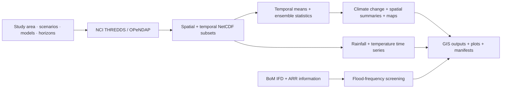

<div align="center">

# NARCliM2 Data and Hazards Analysis

**A configurable Python workflow for climate projections, ensemble analysis, spatial hazard assessment, climate time series, and flood-frequency screening.**

[](https://www.python.org/)   

[Overview](#overview) · [Configuration](#climate-data-and-model-configuration) · [Workflows](#analysis-workflows) · [Outputs](#output-organisation) · [Example notebook](NARCliM_Example.ipynb)

</div>

---

## Overview

This package transforms **NARCliM2.0** climate projections hosted by **NCI THREDDS / OPeNDAP** into reproducible, GIS-ready datasets for user-defined **points and polygons**. It separates data discovery and extraction from climate-model ensemble statistics, spatial summaries, temporal analysis, mapping and a complementary BoM/ARR flood-frequency screening workflow.

### Capabilities

| Workflow | Main functions | Outputs |
|---|---|---|
| **Climate data extraction** | Discover NCI catalogues; select domain, variable, scenario, model, period and study area; remotely subset NetCDF | NetCDF, processing manifests |
| **Ensemble analysis** | Temporal means per GCM × RCM; pixel-wise minimum, optional mean and maximum; baseline-relative change | GeoTIFF, GeoPackage |
| **Spatial hazard summaries** | Polygon zonal averages and point sampling for planning areas, assets and catchments | GeoPackage, CSV |
| **Rainfall and temperature time series** | Monthly, seasonal and annual aggregation; member alignment; ensemble statistics and plots | NetCDF, CSV, plots |
| **Ensemble mapping** | Maps of ensemble statistics for selected scenarios and variables | Map images |
| **Flood-frequency screening** | BoM design rainfall, ARR climate-change and loss information; equivalent future event frequency | GeoPackage, CSV, runoff curves |

### Processing architecture



> [!NOTE]
> The BoM/ARR flood workflow is **separate** from the NARCliM extraction and ensemble branches. It estimates changes in equivalent flood frequency; it does **not** simulate flood extent, depth or velocity.

## Installation and quick start

Clone the repository and install in editable mode (Python 3.11+ recommended):

```bash
git clone https://github.com/AlluviumGroup/NARCliM2-Data-and-Hazards-Analysis.git
cd NARCliM2-Data-and-Hazards-Analysis
python -m pip install -e .
python -c "import narclim_workflow; print(narclim_workflow.__file__)"
```

For development dependencies, use `python -m pip install -e ".[dev]"` where supported by the project configuration. See [`NARCliM_Example.ipynb`](NARCliM_Example.ipynb) for the full, staged workflow.

```python
from pathlib import Path
from narclim_workflow import run_workflow

manifest = run_workflow(
    vector_path=Path(r"C:\path\to\study_area.shp"),
    output_root=Path(r"C:\NARCliM_Outputs"),
    time_windows={"baseline": (1985, 2014), "mid_term": (2041, 2060)},
    variables=["TXge35", "R99p", "FFDIgt50"],
    scenarios=["historical", "ssp245"],
    gcms=["ACCESS-ESM1-5"],
    rcms=["NARCliM2-0-WRF412R3"],
    domain_key="auto",
    overwrite=False,
)
print(manifest["status"].value_counts(dropna=False))
```

> [!TIP]
> Start with one variable, one GCM, one RCM and a short time window to check catalogue availability, data access and outputs before processing a full ensemble.

## Climate data and model configuration

All selections are configurable in Python; the tables below describe the options illustrated in the package documentation. **Availability varies by variable, scenario, domain, model and period.**

### Study areas and spatial domains

Point and polygon inputs are supported, including multiple features. Set `id_field` to produce feature-specific outputs. The `domain_key="auto"` option chooses the higher-resolution South-East Australia domain when the study area is fully covered; otherwise it selects the Australia-wide domain.

| Domain | Configuration | Approximate resolution | Coverage |
|---|---|---|---|
| NARCliM2-0-SEAus-04 | `"seaus_4km"` | 4 km | South-East Australia |
| AUS-18 | `"aus_18"` | 18 km | Australia-wide |
| Automatic | `"auto"` | Selected automatically | Depends on study area |

```python
DOMAIN_KEY = "auto"  # or "seaus_4km", "aus_18"
```

### Emissions scenarios

| Scenario | Meaning |
|---|---|
| `historical` | Historical climate simulations |
| `ssp126` | SSP1-2.6 low-emissions pathway |
| `ssp245` | SSP2-4.5 intermediate pathway |
| `ssp370` | SSP3-7.0 higher-emissions pathway |

```python
SCENARIOS = ["historical", "ssp126", "ssp245", "ssp370"]
```

### Time horizons

Time windows are **user-defined**, not fixed by the package. For example:

| Window | Years | Use |
|---|---|---|
| `baseline` | 1985–2014 | Historical reference |
| `short_term` | 2021–2040 | Near-term projections |
| `mid_term` | 2041–2060 | Mid-century projections |
| `long_term` | 2081–2100 | Late-century projections |

```python
TIME_WINDOWS = {
    "baseline": (1985, 2014),
    "short_term": (2021, 2040),
    "mid_term": (2041, 2060),
    "long_term": (2081, 2100),
}
```

Historical NARCliM coverage is generally 1951–2014 and projection coverage 2015–2100. Check actual catalogue availability before running a requested combination.

### Global and regional climate models

The illustrated configuration uses **five GCMs × two RCMs = up to ten ensemble members**. The number contributing to any result can be smaller if data are unavailable.

| Global climate model (GCM) | Realisation |
|---|---|
| `ACCESS-ESM1-5` | `r6i1p1f1` |
| `EC-Earth3-Veg` | `r1i1p1f1` |
| `MPI-ESM1-2-HR` | `r1i1p1f1` |
| `NorESM2-MM` | `r1i1p1f1` |
| `UKESM1-0-LL` | `r1i1p1f2` |

| Regional climate model (RCM) |
|---|
| `NARCliM2-0-WRF412R3` |
| `NARCliM2-0-WRF412R5` |

```python
GCMS = ["ACCESS-ESM1-5", "EC-Earth3-Veg", "MPI-ESM1-2-HR", "NorESM2-MM", "UKESM1-0-LL"]
RCMS = ["NARCliM2-0-WRF412R3", "NARCliM2-0-WRF412R5"]
```

### Climate variables and indicators

| Variable | Interpretation | Source branch | Frequency |
|---|---|---|---|
| `prAdjust` | Bias-adjusted precipitation | Bias-adjusted output | Daily |
| `tasmaxAdjust` | Bias-adjusted maximum temperature | Bias-adjusted output | Daily |
| `tasminAdjust` | Bias-adjusted minimum temperature | Bias-adjusted output | Daily |
| `tasmeanAdjust` | Mean of maximum and minimum temperature; calculated locally | Derived | Daily |
| `TXge35` | Days with Tmax ≥ 35 °C | Bias-adjusted output | Yearly |
| `TNlt2` | Days with Tmin < 2 °C | Bias-adjusted output | Yearly |
| `FFDIgt50` | Days with FFDI ≥ 50 | DD | Yearly |
| `R20mm` | Days with precipitation ≥ 20 mm | DD | Yearly |
| `R99p` | Precipitation from extremely wet days | DD | Yearly |
| `SPI12` | 12-month Standardised Precipitation Index | DD | Monthly |
| `StormDays` | Wind-threshold exceedance days derived from `sfcWindmax` | Derived | Yearly |

For `StormDays`, `storm_threshold_kmh=89.0` produces `StormDaysGT89`; `save_storm_source=True` retains daily wind subsets for quality assurance. Mean temperature is derived as `(tasmaxAdjust + tasminAdjust) / 2`.

## Analysis workflows

### 1. Climate data discovery, download and subsetting

**Module:** `workflow.py` · **Entry point:** `run_workflow`

Discovers NCI THREDDS datasets, opens remote NetCDF using OPeNDAP, subsets by requested dates and study-area bounding box, saves local NetCDF files and writes a processing manifest. Unsupported model/scenario combinations are reported rather than treated as zero values. The [quick-start example](#installation-and-quick-start) demonstrates this workflow.

### 2. Ensemble uncertainty and climate change

**Module:** `uncertainty.py` · **Entry point:** `run_uncertainty_workflow`

First temporally average each available **GCM × RCM** member over the selected horizon; then calculate the **pixel-wise minimum, optional mean and maximum across members**. Future change products subtract the corresponding historical-baseline statistic.

```text
Member temporal averages → Ensemble Min / [Mean] / Max
Future ensemble statistic − Historical baseline statistic → Change raster
```

> [!IMPORTANT]
> Ensemble minimum and maximum describe **between-model spread after temporal averaging**. They are not annual extremes, confidence intervals or probabilities.

```python
from pathlib import Path
from narclim_workflow.uncertainty import run_uncertainty_workflow

manifest = run_uncertainty_workflow(
    input_root=Path(r"C:\NARCliM_Outputs"),
    boundary_path=Path(r"C:\path\to\study_area.shp"),
    variables=["TXge35", "FFDIgt50", "R99p", "StormDaysGT89"],
    scenarios=["historical", "ssp245", "ssp370"],
    time_windows=["baseline", "mid_term", "long_term"],
    include_mean=False,
    calculate_change=True,
    baseline_scenario="historical",
    baseline_time_horizon="baseline",
    overwrite=False,
)
```

Example outputs: `TXge35_Min_ssp245_2041_2060.tif`, `TXge35_Max_ssp245_2041_2060.tif`, `TXge35_Change_Min_ssp245_2041_2060.tif`. Set `include_mean=True` to also produce Mean and Change-Mean products.

### 3. Spatial climate-hazard summaries

**Module:** `spatial_summary.py` · **Entry point:** `run_spatial_summary`

Transfers ensemble rasters to planning zones, catchments, sites and assets. **Polygons** receive the spatial mean of raster values in the feature; **points** sample the containing raster cell. This applies separately to each ensemble-statistic raster and can include baseline values and scenario changes.

```python
from pathlib import Path
from narclim_workflow.spatial_summary import run_spatial_summary

outputs = run_spatial_summary(
    feature_path=Path(r"C:\path\to\planning_zones.shp"),
    climate_indices_root=Path(r"C:\NARCliM_Outputs\Climate_Indicies"),
    dataset_name="Planning_Zones",
    all_touched=True,
    include_mean=False,
    calculate_change=True,
    overwrite=True,
)
```

Produces datasets such as `Planning_Zones_Hazards.gpkg` and `Planning_Zones_Hazards.csv`. A polygon's `min` and `max` attributes are **spatial means of ensemble-min and ensemble-max rasters**, not its smallest and largest raster cells.

### 4. Rainfall and temperature time-series analysis

**Module:** `rain_temp_timeseries.py` · **Entry point:** `run_rain_temp_timeseries`

Unlike whole-horizon ensemble averages, this workflow **retains temporal variability**. It aggregates daily rainfall and temperature data per model, aligns member time coordinates, calculates time-step ensemble statistics and creates study-area time-series plots.

| Frequency | Rainfall | Temperature |
|---|---|---|
| Monthly | Total precipitation | Mean temperature |
| Seasonal | Total precipitation | Mean temperature |
| Annual | Total precipitation | Mean temperature |

Seasons are **DJF, MAM, JJA, SON**. December belongs to the following DJF year; incomplete seasons are removed, and annual results require all 12 months.

```python
from pathlib import Path
from narclim_workflow import run_rain_temp_timeseries

manifest = run_rain_temp_timeseries(
    input_root=Path(r"C:\NARCliM_Outputs"),
    variables=["prAdjust", "tasmaxAdjust", "tasminAdjust", "tasmeanAdjust"],
    frequencies=["Monthly", "Seasonal", "Annual"],
    scenarios=None,       # Discover available scenarios
    time_windows=None,    # Discover available time windows
    output_folder_name="Climate_Indicies",
    plot_dpi=300,
    show_plots=False,
    overwrite=False,
)
```

**Outputs:** gridded NetCDF ensemble statistics at each time step, CSV series and plots. In CSVs and plots, members are first spatially averaged over the study area and then combined into ensemble statistics; gridded NetCDF statistics are calculated pixel-by-pixel.

### 5. Ensemble hazard mapping

**Module:** `ensemble_maps.py` · **Entry point:** `plot_ensemble_maps`

Generates reproducible map images from ensemble-statistic rasters, with configurable variables, scenarios, statistics, colour map, resolution and display options.

```python
from pathlib import Path
from narclim_workflow.ensemble_maps import plot_ensemble_maps

maps = plot_ensemble_maps(
    input_root=Path(r"C:\NARCliM_Outputs"),
    boundary_path=Path(r"C:\path\to\study_area.shp"),
    statistics=["min", "max"],  # Include "mean" if generated
    cmap="viridis",
    dpi=300,
    overwrite=True,
    show=False,
)
```

Maps are saved in `Climate_Indicies/Plot and Maps/`.

### 6. Climate-adjusted flood-frequency screening

**Module:** `flood.py` · **Entry point:** `run_flood_hazard`

This **separate flood-hazard workflow** combines Bureau of Meteorology design rainfall (IFD) with Australian Rainfall and Runoff (ARR) climate-change and loss information. It compares current design rainfall-runoff events with adjusted future conditions to estimate **equivalent future flood frequency** for selected locations.

**Method:** select locations and urban/rural context → obtain BoM/ARR inputs → calculate current design-event runoff → adjust future rainfall and relevant losses → compare runoff-frequency curves → report equivalent future event frequency.

| Default parameter | Value |
|---|---|
| Current design-event ARIs | 1, 10 and 100 years |
| Urban rainfall duration | 1 hour |
| Rural rainfall duration | 24 hours |

```python
from pathlib import Path
from narclim_workflow import run_flood_hazard

results = run_flood_hazard(
    output_root=Path(r"C:\NARCliM_Outputs"),
    time_windows={
        "baseline": (1985, 2014),
        "mid_term": (2041, 2060),
        "long_term": (2081, 2100),
    },
    scenarios=["historical", "ssp245", "ssp370"],
    location_path=Path(r"C:\path\to\flood_locations.gpkg"),
    name_field="Name",
    context_field="Context",
    overwrite=False,
    verbose=True,
)
```

**Outputs:** `Flood_Hazard.gpkg`, `Flood_Hazard.csv`, `Flood_Runoff_Curves.csv`, runoff curves and supporting QA/source files.

> [!WARNING]
> **Screening method only.** This is not a hydraulic flood model and does not calculate flood extents, inundation depths, velocities, channel routing, stormwater or culvert capacity, or property-scale flood impacts.

## Output organisation

The package keeps downloaded climate data separate from derived products. The folder name `Climate_Indicies` reflects the **current package convention** and is deliberately retained for compatibility.

```text
<OUTPUT_ROOT>/
├── NARCliM Data/
│   ├── prAdjust/  tasmaxAdjust/  tasminAdjust/
│   ├── TXge35/  R99p/  FFDIgt50/  SPI12/
│   ├── sfcWindmax/              # Optional retained storm source
│   ├── StormDaysGT<threshold>/ # Derived storm indicator
│   └── Flood/                   # BoM/ARR source and QA data
└── Climate_Indicies/
    ├── Temporal_Average/
    ├── Ensemble_Stats/
    ├── Hazards/
    │   ├── Ensemble_summary_all_variables.gpkg
    │   ├── Ensemble_summary_<variable>.gpkg
    │   ├── <dataset>_Hazards.gpkg
    │   ├── <dataset>_Hazards.csv
    │   └── Flood/
    │       ├── Flood_Hazard.gpkg
    │       ├── Flood_Hazard.csv
    │       └── Flood_Runoff_Curves.csv
    ├── Rain_Temp_Timeseries/
    │   └── <scenario>/<time_window>/<frequency>/
    │       ├── NetCDF/
    │       ├── CSV/
    │       └── Plots/
    └── Plot and Maps/
```

Outputs use variable-aware precision: `StormDaysGT*` is retained to three decimal places; other climate indicators generally use one decimal place.

## Package structure

```text
src/narclim_workflow/
├── __init__.py
├── catalog.py              # Remote catalogue access
├── config.py               # Configuration
├── domain.py               # Domain selection
├── spatial.py              # Spatial utilities
├── workflow.py             # Extraction and subsetting
├── uncertainty.py          # Temporal means and ensembles
├── spatial_summary.py      # Polygon/point summaries
├── ensemble_maps.py        # Mapping
├── rain_temp_timeseries.py # Monthly/seasonal/annual analysis
└── flood.py                # BoM/ARR flood screening
```

## Quality assurance and scientific interpretation

Before using products in a climate-risk assessment, check **CRS and spatial alignment**, domain coverage, raster resolution, nodata and valid cells, available model-member counts, scenario and time coverage, temporal aggregation, storm threshold units, polygon sampling assumptions and flood-method settings. The extraction workflow provides processing manifests, and storm source subsets can be retained for QA.

> [!IMPORTANT]
> **Interpretation sequence:** daily/monthly climate data → temporal aggregation for each GCM × RCM → ensemble statistics across members → optional future-minus-baseline change → spatial summaries for user features. Do not interpret ensemble min/max as annual extremes or probability bounds; unavailable model combinations are not zero climate values.

## Development and contributions

Check changes before committing, especially when local climate data or generated outputs are present:

```bash
git status
git diff
# Stage only intended source or documentation files
git add README.md
git commit -m "Improve NARCliM documentation"
```

The project may be maintained on multiple GitHub remotes. Push only after confirming the target branches are compatible; do not force-push divergent histories. Keep large datasets, generated results and local paths excluded through `.gitignore`.

## Citation and acknowledgement

**Developer:** Jabbar Khaledi  
**Language:** Python  
**Climate data:** NARCliM2.0, accessed through NCI THREDDS  
**Additional flood inputs:** Bureau of Meteorology (BoM) and Australian Rainfall and Runoff (ARR)

If using or adapting the software, consult the repository's [`CITATION.cff`](CITATION.cff) and acknowledge the underlying climate and flood data sources appropriately.

---

**Full worked examples:** [`NARCliM_Example.ipynb`](NARCliM_Example.ipynb)
